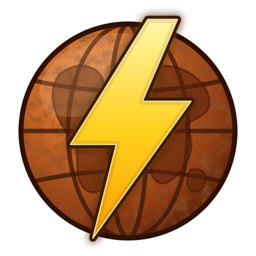
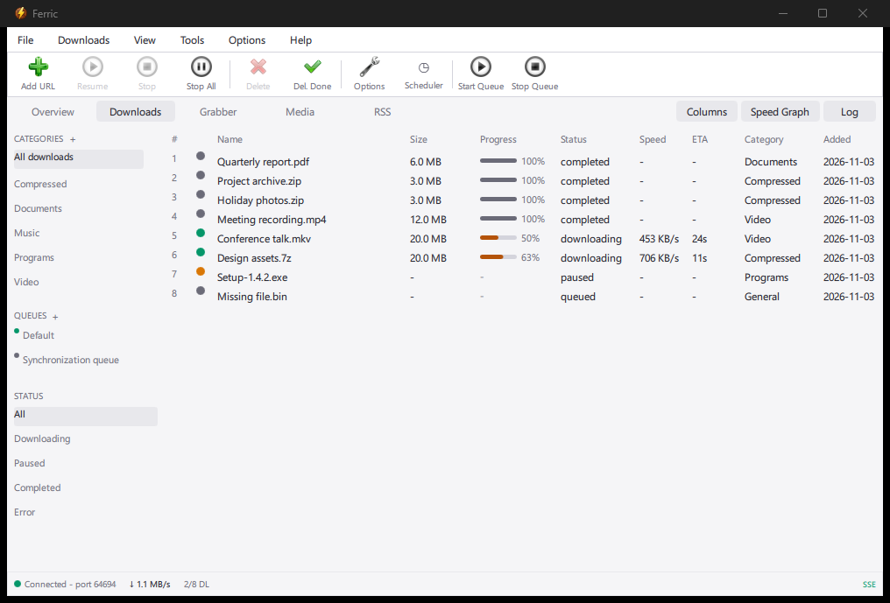
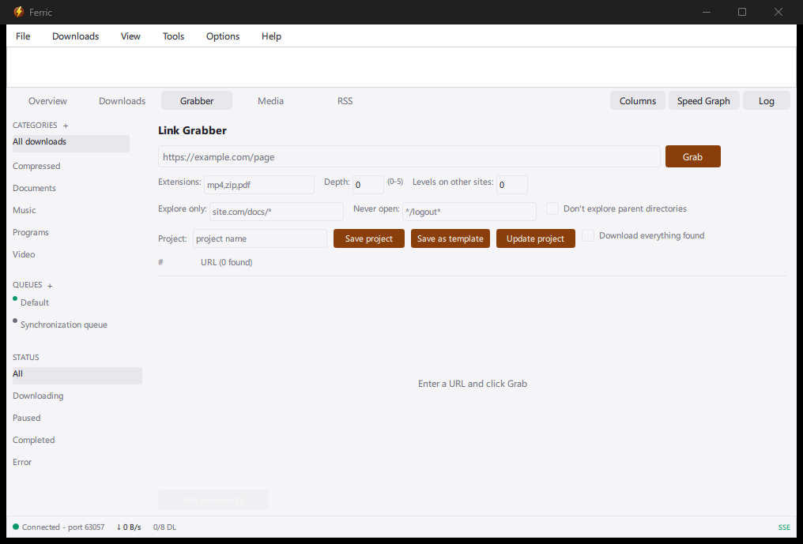
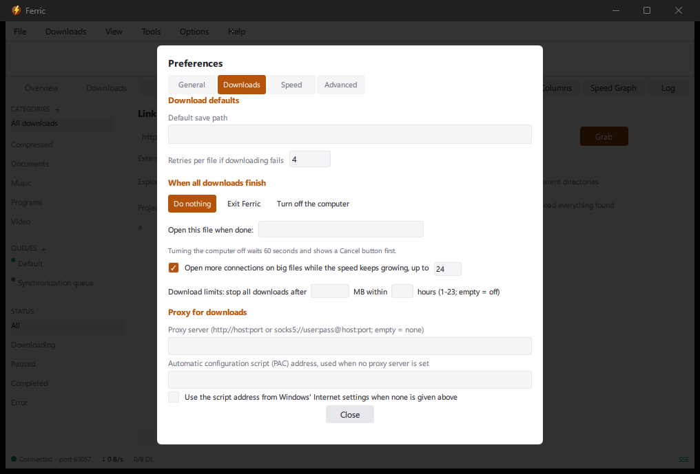

<p align="center">
  
</p>

<h1 align="center">Ferric</h1>

<p align="center">
  <strong>A fast, open-source download manager for Windows.</strong><br>
  Multi-connection downloads that adapt to the server, browser capture, queues and scheduling, media downloads, and a clean native interface.
</p>

<p align="center">
  
  
  
  
  
</p>

<p align="center">
  
</p>

<p align="center">
  
  
</p>

## Highlights

- **Fast.** Files are split into pieces fetched over parallel connections. On large files Ferric keeps adding connections for as long as the measured speed keeps growing (up to 24), backs off when the server pushes back, and steals work from slow pieces so one stalled connection never holds a download up.
- **Takes over browser downloads.** A Chrome / Edge / Brave / Firefox extension hands downloads to Ferric the moment the browser starts them, with a *Download File Info* dialog (name, folder, category, description) that appears while the transfer is already running.
- **Queues and scheduling.** Several queues, weekday and time windows, periodic re-checks, per-queue retry and *when finished* actions, plus download limits (stop after N MB in a time window).
- **Media.** Video and audio from many sites through built-in extractors and yt-dlp; separate video and audio streams are fetched in parallel and merged with ffmpeg.
- **Site Grabber.** Crawl a site for files with include and exclude patterns, link depth, other-site levels, saved projects and templates, and one-click *Update*.
- **Careful with your network.** Basic, Digest and NTLM logins, saved site logins (encrypted with your Windows account), HTTP and SOCKS5 proxies, proxy auto-config (PAC) scripts, FTP and SFTP.
- **Private and safe by default.** Private addresses are blocked unless you allow them, cookies live only as long as their download, the native host only talks to the extension it was built for, and the extension never reads browser cookie databases.

## Performance

Measured on a local test server that allows 1 MB/s per connection and 24 MB/s in total, downloading a 120 MB file:

| Download manager | Time |
|---|---|
| Ferric (adaptive connections) | about 10 s |
| A conventional manager limited to 8 connections | about 16 s |

One server and one file size: real-world results depend on the server and your line. When the line itself is the limit, Ferric simply matches it.

## Install

1. Download `Ferric-<version>-win-x64.zip` from the [Releases](../../releases) page and unzip it anywhere.
2. Double-click `Install-Ferric.cmd`. It installs for the current user only (no administrator rights) into `%LOCALAPPDATA%\Programs\Ferric`, registers the browser connection, and adds a Start Menu shortcut.
3. Load the browser extension from the install folder's `extension` directory: open `chrome://extensions` (or `edge://extensions`), turn on **Developer mode**, choose **Load unpacked**, and select that folder. For Firefox, run `npm run build:firefox` in `extension` and load the result as a temporary add-on.

> Ferric is not code-signed yet, so Windows SmartScreen may show a warning the first time you run it.

To remove it, run `Uninstall-Ferric.ps1` from the install folder.

### Code signing

Ferric applies to the [SignPath Foundation](https://signpath.org/) for free code signing of its Windows releases. Until a signed release is published, the downloads above are unsigned. Once approved, releases are built from this repository by an automated workflow and signed with a certificate provided by the SignPath Foundation (the signer shown by Windows will be "SignPath Foundation"). Ferric's [privacy policy](docs/privacy-policy.md): it collects nothing and has no telemetry.

## Using Ferric

- **Add a download:** click **Add URL**, paste a link, or just download something in your browser.
- **Choose where it goes:** categories (Compressed, Documents, Music, Programs, Video) each have their own folder; change them under *Options > Preferences*.
- **Schedule:** open the **Scheduler** from the toolbar to set times and limits per queue.
- **Portable mode:** create an empty file named `portable` next to `ferricd.exe` and Ferric keeps its data in a `data` folder beside it.

## Build from source

Requirements: Rust (stable), Qt 6.8 (MSVC 2022 build) for the UI, Node.js for the extension.

```powershell
# daemon and browser relay
cargo build -p ferricd -p ferric-host --release

# desktop UI
$env:QMAKE = "C:/Qt/6.8.3/msvc2022_64/bin/qmake.exe"
cargo build -p ferric-qt --release

# extension
cd extension; npm install; npm run build; cd ..

# package and installer zip
.\scripts\package-windows.ps1 -Release
```

The native host only trusts extension IDs compiled in at build time (`FERRIC_EXTENSION_ID`, `FERRIC_FIREFOX_EXTENSION_ID`).

### Checks

Run every check before you push:

```powershell
powershell -ExecutionPolicy Bypass -File scripts\ci-local.ps1
```

It runs formatting, clippy, the workspace tests, the Qt build check, the extension build and tests, `cargo audit` and `cargo deny`. See [CONTRIBUTING.md](CONTRIBUTING.md).

## Architecture

| Crate | Role |
|---|---|
| `ferricd` | Download daemon: engine, queues, scheduler, local HTTP API (Tokio, SQLite) |
| `ferric-qt` | Desktop interface (Qt 6 / QML through cxx-qt) |
| `ferric-host` | Browser native-messaging relay |
| `ferric-extract` | Site extractors and the media pipeline |
| `ferric-cli` | Command-line client for the daemon |
| `ferric-common` | Shared types, models and errors |
| `extension/` | Chrome, Edge, Brave and Firefox extension (Plasmo, TypeScript) |

## Project status

Ferric is a **release candidate**: it is used daily and heavily tested (hundreds of automated tests), but it is not code-signed yet, the Chrome and Edge extension is loaded unpacked, and the Firefox add-on is unsigned. Windows is the supported platform. See the [changelog](CHANGELOG.md) for what changed in each release.

## Contributing and security

Contributions are welcome: please read [CONTRIBUTING.md](CONTRIBUTING.md). To report a vulnerability, see [SECURITY.md](SECURITY.md).

## License

[MIT](LICENSE)
